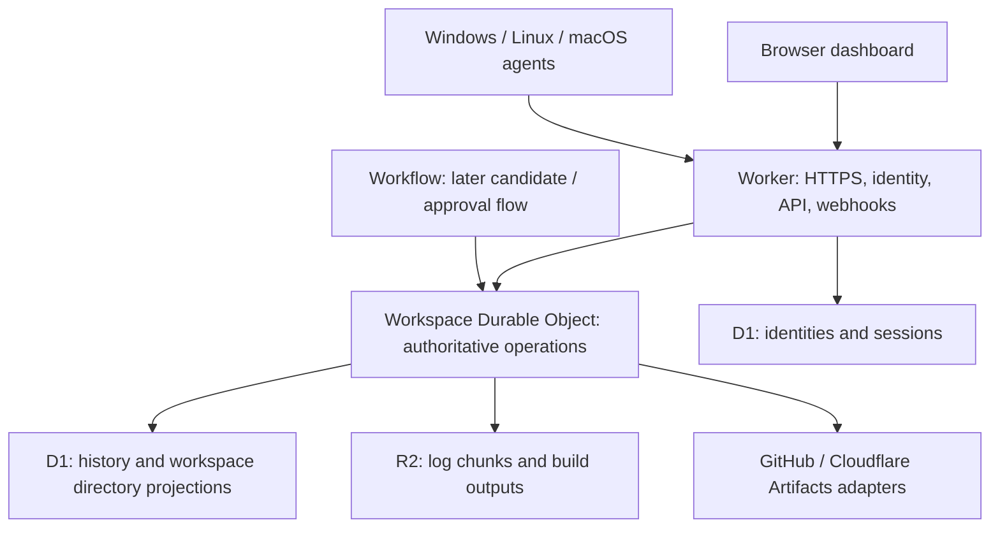

# Smith Cloudflare coordinator experiment

Date: 2026-10-04

Status: target architecture for `feature/cloudflare-experiment`; A0 fixture coordinator implemented, broader migration in progress. See [operations](../../cloudflare/operations.md) for actual coverage.

Repository baseline: `Red-Marmoset/smith` at `a26e4132505aa9e0a9a221bee8407f773d390a43`.

## Purpose and scope

Make **Smith — System for Managed Integration, Testing & Handoff** usable as a
Cloudflare-hosted service, with users choosing how they sign in and attaching
their own build machines. Extend that foundation to coordinate concurrent AI
coding tasks, verify their outputs, and hand off an approved result.

The experimental public URL is **https://exp.redmarmosetstudios.com**. The first
major task is a coordinator actually executing on Cloudflare, independent of the
developer's machine. A local coordinator behind a tunnel does not meet that
requirement. Both the dashboard and experimental agents use this origin. Use
separate experiment resources and credentials from production.

The user requested a new experimental branch, a checked-in plan, and a push.
This document records target implementation decisions. The hosted fixture service
is deployed; implemented coverage and evidence are tracked in the operations
documents. Broader integrations and AI execution are not yet implemented.

The first release target is an invite-only hosted experiment with workspace
isolation from the outset. Open registration, billing, enterprise provisioning,
and an arbitrary public runner marketplace are outside the first release.
Keep the Smith name and acronym. The unrelated `sibyllinesoft/smith-core` and
`smith-gateway` projects are not dependencies or evidence about this codebase.

## What we can reuse

| Existing source | Existing responsibility | Hosted treatment |
| --- | --- | --- |
| `Modules/SmithProtocol/WireTypes.h`, `WireJson.cpp` | Agent messages, resolved jobs, logs, results | Version and extend; maintain compatibility fixtures |
| `Modules/SmithCore/RepoConfig.cpp`, `Variants.cpp` | `smith.json`, products, variants and rules | Port semantics to TypeScript, using C++ test fixtures as the reference |
| `Modules/SmithCore/NodeMatcher.cpp`, `Batches.cpp`, `Inputs.cpp` | Node selection, affinity, batches and artifact fan-in | Port pure decisions and compare results against shared fixtures |
| `Modules/SmithCoordinator/CoordinatorJobs.cpp` | Queue, assignment, result processing, retries | Replace process-local state with durable transactions and attempt leases |
| `Modules/SmithCoordinator/CoordinatorProjects.cpp`, `CoordinatorTriggers.cpp` | Local clones, pipeline discovery, polling and schedules | Provider API reads, bounded discovery jobs, webhooks and durable schedules |
| `Modules/SmithCore/Store.cpp` | JSON records, logs and artifact files | Durable Object SQLite, D1 projections and R2 objects |
| `Modules/SmithCoordinator/CoordinatorAuth.cpp` | Google sign-in, users, opaque sessions | Provider-neutral identity and scoped authorization in Workers |
| `Modules/SmithAgent/Agent.cpp`, `AgentHandoff.cpp` | Checkout, process execution, collection, handoff | Retain C++; add secure transport, attempt fencing and isolated task workspaces |
| `web/` | Vanilla dashboard | Retain the framework-free UI; adapt its authentication and API access |
| `Modules/SmithTray/` | Desktop integration | Retain; allow attachment to a hosted coordinator |

The local coordinator assumes a durable filesystem, background threads, mutexes,
Git subprocesses and an optional embedded agent. Those assumptions do not map
directly onto Workers. The engine's `Modules/Http/Module.manifest` explicitly
describes its client as plain HTTP without TLS; `AgentUtil.h` uses that client,
including an additional direct client path for artifact downloads in `Agent.cpp`.
An HTTPS coordinator therefore requires agent work, even before lease support.

## Selected approach and alternatives

Build a TypeScript coordinator under `cloudflare/coordinator/`, serving the
existing dashboard and retaining native C++ execution agents. This gives the
hosted state an explicit lifecycle and lets Workers handle HTTPS and identity.
It also preserves platform-specific builds and the repo-owned pipeline model.

Running the current Linux coordinator in a Cloudflare Container is a possible
compatibility experiment, but leaves its disk persistence, singleton recovery,
tenant ownership and authentication model to be redesigned. It is not the
selected primary architecture. Porting the entire coordinator to WebAssembly
would still require replacing process, filesystem and networking interfaces;
reserve WASM for a measured need to share a particular pure algorithm.

## Architecture and ownership

Start with **one SQLite-backed Durable Object per workspace**. A workspace owns
its projects, memberships, enrolled nodes, queue, job attempts, batches,
approvals, schedules and operational audit records. One user can own a personal
workspace and belong to a team workspace. This provides one scheduling authority
for a shared fleet without cross-object node reservations. Put explicit quotas
on each workspace; measure before introducing scheduler sharding.

D1 owns global users, external identities and browser sessions. Workspace
membership and role decisions remain authoritative in the workspace object.
D1's workspace directory and build-history tables are read projections only.
They must never authorize access or assign jobs. Current state and authorization
are read from the workspace object, including when a history projection is stale.

Each state transition persists its event and an outbox entry in the same SQLite
transaction. An alarm drains the outbox into D1 using workspace/event IDs and
monotonic revisions. Duplicate or older events cannot overwrite newer records.
Failed projection writes do not lose a completed build. No external HTTP call is
made inside a synchronous SQLite transaction.

R2 holds immutable, namespaced objects. The workspace object owns their manifests
and access decisions. Log objects use workspace/job/attempt/sequence keys;
artifacts use workspace/job/attempt/upload IDs. Names supplied by a client never
become unrestricted bucket paths. Object bytes are streamed and bounded.

Use Durable Object alarms for lease expiry, schedule checks and outbox retries.
Each object has one alarm: persist all due work and schedule the earliest due
timestamp after every update. Handlers must tolerate duplicate invocation and
recover after eviction. Workflows can later coordinate candidate evaluation and
approval waits; only the workspace object mutates job state.

## Identity, permissions and service connections

Separate three relationships:

1. A stable Smith user links to external identities keyed by provider, issuer and
   subject. Email is a contact attribute; do not automatically link two providers
   merely because they return the same email.
2. A user has workspace membership and roles. Start with owner, admin, operator
   and viewer. Owners manage ownership; admins manage membership, providers and
   enrolled nodes; operators trigger/cancel builds and approve permitted handoffs;
   viewers read allowed project state. Only owners/admins may change connection
   grants. Check access on every route, event subscription and object download.
3. A service connection grants a workspace access to selected external resources.
   A GitHub login does not grant repository access. Use a separate GitHub App
   installation connection for repository access and webhook delivery.

First implement Google sign-in with the new identity model, then GitHub login
and configurable OIDC for workspace administrators. Microsoft can use OIDC;
Apple, passkeys and SAML are separately scoped follow-on integrations. Provider
configuration is validated, versioned and restricted to administrators. Never
accept a caller-supplied issuer or token endpoint on a login request. Custom OIDC
endpoints require HTTPS and SSRF controls, including redirects and DNS resolution.

Use a maintained Workers-compatible OAuth/OIDC implementation; validate issuer,
audience, signature, expiry, nonce and state, with PKCE where applicable. Select
and pin that dependency during implementation after a compatibility test. Use
opaque session cookies with Secure, HttpOnly and appropriate SameSite settings,
CSRF protection and server-side revocation. Account linking requires a current
session and reauthentication. A removed membership takes effect on subsequent
operations and live subscriptions. Protect the final owner against deletion.

Agent identity is separate from browser identity. An admin issues a one-use,
short-lived enrollment code bound to one workspace. Redemption returns a node ID
and a revocable node credential. Store credential hashes, scope nodes to allowed
projects and job classes, and rotate/revoke independently. A node ID or a hostname
in request JSON is not proof of identity. There is no public loopback bypass or
global operator token accepted as a hosted user's session.

Provider secrets and refresh tokens are encrypted with versioned keys held in
Worker secrets and bound to their workspace/connection as authenticated context.
Audit access without recording secret values. Native builds necessarily receive
some execution credentials: mint short-lived, repository-scoped checkout tokens
and supply only the secrets required by the approved job. Do not claim that a
build runner holding such a token cannot read it. Production deployment secrets
are unavailable to speculative coding jobs.

## Agent transport and protocol

Introduce an agent transport abstraction for JSON requests and streamed file
transfers. For the experiment, implement HTTPS using installed `curl`, invoked
with direct argv and owner-restricted temporary configuration/body files. Secrets
must not appear in argv, process logs or diagnostics. Verify TLS certificates,
reject downgrade redirects, and never forward coordinator authorization to a
different origin. Presigned R2 requests use their own transport context without
the node's bearer credential. Missing `curl` produces an actionable startup error.
Retain the plain HTTP adapter for the local coordinator.

This follows the repository's existing external-HTTPS convention and avoids a
new engine dependency. Test file permissions and cleanup on all three operating
systems. Native TLS can replace this adapter later if profiling shows subprocess
overhead matters. Existing agent binaries cannot be promised to work unchanged.

Keep protocol v1 for the LAN coordinator. Add a hosted v2 envelope, negotiated
at registration, with `workspaceId`, stable `nodeId`, `jobId`, `attemptId`,
`leaseToken`, `leaseExpiresAt` and event sequence identifiers. Hosted endpoints
reject unsupported versions explicitly. New agents select the adapter/protocol
from configuration and the registration response; do not silently downgrade a
hosted connection to legacy authentication. Start with bounded HTTP polling;
WebSocket agent transport is a later optimization supported by measurements.

## Job state, retries and side effects

Persist the state machine:

`queued -> leased -> running -> success | failed | error | cancelled | lost`

Assignment atomically reserves the node and creates an attempt. The response is
replayable if the reply is lost; a second poll must not lease another job to the
same busy node. Use server time: initial defaults are a 90-second lease renewed
every 15 seconds, configurable per deployment. Every status, log, upload grant
and result is checked against the authenticated node and current attempt.

Expired leases fence the old attempt. A heartbeat arriving later cannot resurrect
it. Repeated identical terminal results acknowledge success; conflicting results
for the same attempt return a conflict. Cancellation persists a request, fences
new side effects, and reaches the runner through heartbeat/poll responses even
when no log output is produced. Attempt completion requires committed artifact
manifests and a final log sequence, or an explicit partial-output error.

A lease alone cannot stop a disconnected process. The agent must track renewal
failure, stop its child process tree when its lease expires, and check a current
lease before each handoff. Give retry-safe build jobs explicit retry policy.
Never automatically retry a deployment whose external outcome is unknown: mark
it for reconciliation. Exactly-once arbitrary shell execution is not promised.

Resolve source commit, pipeline configuration and all required repository SHAs
before dispatch. Record a digest of the resolved specification. Artifact inputs
identify concrete attempt manifests; never substitute an unrelated "latest"
output after approval. Use isolated job/attempt directories for hosted runs,
particularly concurrent AI candidates. Shared compiler/download caches may be
reused only within a trust boundary and must not supply another task's working tree.

## Repository access and existing feature parity

Read `smith.json` and repository metadata at a pinned SHA using GitHub APIs or
Artifacts bindings. Static glob-based variant discovery uses the repository tree
at that SHA with bounded pagination. If it needs generated files or an executable
probe, use a discovery job on an enrolled runner; never run repository code in the
coordinator. Additional repo refs and Git submodules retain their declared access
boundaries. Reject or clearly label unsupported pipeline features at import.

Port node selectors, soft OS affinity, explicit target OS, coalescing, retry
classification, batch pinning and artifact fan-in using shared fixtures. Preserve
the deliberate distinction between automatic triggers and manual/rerun/batch
jobs. Authenticate webhooks, deduplicate delivery IDs and enqueue the commit from
the event. Polling is a fallback; schedules use explicit UTC semantics in the
hosted product with the timezone displayed to the user.

Large outputs bypass the coordinator request body through scoped, expiring R2
upload grants and multipart uploads. Commit a manifest only after checking the
uploaded object's size, checksum and attempt ownership. Orphaned uploads expire.
Persist log chunks before acknowledging their sequence, and resume reads from a
cursor after a browser reconnect. Historical logs and artifact downloads require
authorization. Keep authentication out of event-stream query strings.

LAN discovery, embedded coordinator/agent mode and dynamic DNS remain local-only.
Discord and Steam Guard are later parity work: isolate their grants and persist
delivery IDs, expiry and acknowledgments. Do not expose them accidentally through
a generic legacy route. The existing dashboard must explicitly show which hosted
features are available.

## Artifacts and concurrent AI work

Once the hosted build loop is reliable, introduce `coding`, `verification` and
`handoff` job classes. An AI task starts from a pinned source snapshot and forks
separate Artifacts repositories. Each candidate has its own runner workspace,
repository credentials, budget, cancellation and retained context.

Cloudflare's documented import operation accepts public HTTPS repositories.
Our Smith repository is private: do not assume direct private GitHub import works.
Use an authorized runner to fetch selected refs with a GitHub installation token
and push them into a newly created Artifacts baseline. Do not mirror every ref
or change a repository's visibility. Record and verify the resulting commit SHA.
Exercise token expiry, fork lifecycle, submodules and cleanup in the adapter tests.

Use dedicated isolated execution environments for untrusted candidate code. An
ordinary Smith build process running as the build user is not a sandbox. Initial
dogfood may use trusted repositories on dedicated disposable machines; public
multi-tenant execution requires a separately verified VM/container isolation
boundary and credential/network restrictions. Runner labels alone are not that
boundary. Windows/macOS builds remain on appropriate native machines.

Verification is a separate job with protected test definitions and no candidate
write credentials. Store source SHA, spec digest, runner identity, attempt,
checks, artifacts and recorded actions as evidence. Distinguish runner-reported
observations from independently verified facts. A Git commit or Git note containing
an agent-written report is not a security attestation.

Promotion binds approval to workspace, project, candidate SHA, target base SHA,
environment and evidence digest. A moved branch or changed candidate invalidates
approval. Start with an approved PR/preview flow; production handoff remains a
separate authorized action. Speculative jobs never hold promotion credentials.

## Delivery gates

0. **Cloudflare-hosted coordinator:** deploy the Worker/API and durable workspace
   state to the experiment hostname. With the local native coordinator stopped,
   authenticated API clients can enqueue, claim and complete a fixture job, and
   state survives redeployment. Show the served deployment revision. Local tests
   are prerequisites, not evidence that this hosting gate is complete.
1. **Hosted build loop:** authenticated user and node; one pinned job; durable
   assignment, logs, artifacts and completion; recovery after network failure and
   object eviction; two-workspace isolation tests.
2. **Coordinator parity and adoption:** provider choice, GitHub connections,
   pipeline import, triggers, batch/fan-in, dashboard and migration tooling;
   explicit unsupported-feature inventory; Windows/Linux/macOS transport evidence.
3. **Concurrent AI experiment:** at least two isolated candidates, independent
   verification, evidence comparison and approval of a selected result; no
   automatic production deployment.
4. **Release decision:** quotas, recovery rehearsal, measured usage/costs,
   security review and staged cutover. Completion of a demo is not completion of
   the general hosted product.

Keep the local coordinator operable during development. Cut over by draining
selected projects and enrolling a canary fleet against the hosted instance;
never let two coordinators independently issue production work to the same node.
Import metadata and history with a dry-run report and checksums. Do not migrate
session tokens or shared credentials; reauthenticate and reenroll. Rollback
drains/fences hosted attempts before restoring local scheduling, and reconciles
external side effects explicitly.

The earlier Cloudflare competition has an October 14 deadline, but the user has
not requested a submission or a public release. Treat that as optional context,
not a deadline that justifies removing correctness gates. The private source
must not be published or relicensed as part of this experiment.

## Constraints carried into implementation

- Preserve the Smith name and System for Managed Integration, Testing & Handoff acronym.
- Build and deployment logic remains in repository-owned scripts and `smith.json`.
- Native headless agents remain free of wxWidgets; platform-specific code stays in platform files.
- Cloudflare-managed databases and HTTPS are deliberate hosted-only changes to the LAN deployment constraints.
- Keep the vanilla web UI; introduce no frontend framework for this migration.
- Persist authoritative state before acknowledging externally visible transitions.
- Every hosted resource belongs to a workspace, and authorization is enforced server-side.
- No real external deployment or production handoff during development; use local emulation and dry-run fixtures until explicitly authorized.
- Use isolated feature branches and commit with `git commit --author="Codex <codex@example.com>"`.

## References checked on 2026-10-04

- [Workers filesystem](https://developers.cloudflare.com/workers/runtime-apis/nodejs/fs/)
- [Durable Object SQLite storage](https://developers.cloudflare.com/durable-objects/api/sqlite-storage-api/)
- [Durable Object lifecycle](https://developers.cloudflare.com/durable-objects/concepts/durable-object-lifecycle/)
- [Durable Object alarms](https://developers.cloudflare.com/durable-objects/api/alarms/)
- [Workers testing](https://developers.cloudflare.com/workers/testing/)
- [Workflows](https://developers.cloudflare.com/workflows/)
- [R2 presigned URLs](https://developers.cloudflare.com/r2/api/s3/presigned-urls/)
- [Artifacts repositories](https://developers.cloudflare.com/artifacts/concepts/repositories/)
- [Artifacts imports](https://developers.cloudflare.com/artifacts/guides/import-repositories/)
- [Cloudflare Git competition context](https://blog.cloudflare.com/next-git-platform-on-cloudflare/)

Recheck API shapes, dependency compatibility and account limits when implementing.
No provisioned Cloudflare account resources or live deployment have been verified
by this planning change.
